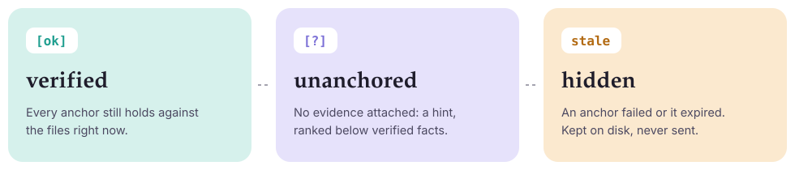

<p align="center">
  
</p>

<p align="center">
  <a href="LICENSE"></a>
  
  
  
</p>

<p align="center">
  <b>Every memory carries evidence. Evidence is re-checked on every recall.<br>
  Stale memories never reach your agent's context.</b>
</p>

<p align="center">
  <a href="#quick-start">Quick start</a> ·
  <a href="#connect-your-agent">Connect your agent</a> ·
  <a href="#anchors">Anchors</a> ·
  <a href="#token-economy">Token economy</a> ·
  <a href="#roadmap">Roadmap</a>
</p>

---

## The problem

Agent memory tools are good at *storing* facts and *finding* them again. They are bad at noticing when a fact stops being true.

Retrieval ranks by similarity, and an outdated memory is exactly as similar to your question as the fact that replaced it. So the agent confidently recalls "the project uses Go 1.23" three weeks after someone upgraded to 1.24, then builds on it. **A confidently wrong memory is worse than no memory at all.**

## The idea

Aletheia stores each memory as a **claim plus anchors**: small pieces of evidence tied to your project's files. Every time a memory is recalled, its anchors are checked against the files *right now*.

<p align="center">
  
</p>

<p align="center">
  
</p>

- Checks are **mechanical**: file hashes, regex matches, path existence. No LLM calls, no embeddings, no network.
- A memory **cannot be created** if its own evidence already contradicts it.
- Nothing is ever deleted. Replaced memories are `superseded`; long-dead ones are archived by `aletheia lethe` (Lethe, the river of forgetting).

## Quick start

```bash
go install github.com/firatmio/aletheia/cmd/aletheia@latest

cd your-project
aletheia init --agents        # creates .aletheia/ and adds usage notes to AGENTS.md

aletheia remember "Auth tokens are issued in src/auth/jwt.go" \
  --anchor file:src/auth/jwt.go \
  --anchor 'contains:src/auth/jwt.go::func IssueToken\(' \
  --tag auth

aletheia recall "auth token"
# 3f9a1c [ok] Auth tokens are issued in src/auth/jwt.go
```

Memories live in `.aletheia/memories/*.md` as plain Markdown with frontmatter. Commit them and your whole team (and every agent) shares one memory that verifies itself on each machine.

<details>
<summary><b>What a memory file looks like</b></summary>

```markdown
---
id: "3f9a1c"
claim: "Auth tokens are issued in src/auth/jwt.go"
confidence: 0.8
status: "active"
source: "claude-code"
created: "2026-10-21T09:12:44Z"
updated: "2026-10-21T09:12:44Z"
tags:
  - "auth"
anchors:
  - "file:src/auth/jwt.go@9b1d0c…"
  - "contains:src/auth/jwt.go::func IssueToken\\("
---
Tokens are HS256, 15 minute expiry. Refresh lives in refresh.go.
```

Edit them by hand, review them in pull requests, grep them. They are just files.
</details>

## Connect your agent

Aletheia speaks **MCP over stdio** and also works as a plain **CLI**, so any agent that can run a shell command can use it.

<details open>
<summary><b>Claude Code</b></summary>

```bash
claude mcp add aletheia -- aletheia serve
```
</details>

<details>
<summary><b>Claude Desktop</b> (<code>claude_desktop_config.json</code>)</summary>

```json
{
  "mcpServers": {
    "aletheia": {
      "command": "aletheia",
      "args": ["serve", "--dir", "/absolute/path/to/your-project"]
    }
  }
}
```
</details>

<details>
<summary><b>VS Code</b> (<code>.vscode/mcp.json</code>)</summary>

```json
{
  "servers": {
    "aletheia": {
      "command": "aletheia",
      "args": ["serve", "--dir", "${workspaceFolder}"]
    }
  }
}
```
</details>

<details>
<summary><b>Cursor, Cline, Windsurf and other MCP clients</b></summary>

```json
{
  "mcpServers": {
    "aletheia": {
      "command": "aletheia",
      "args": ["serve", "--dir", "/absolute/path/to/your-project"]
    }
  }
}
```
</details>

<details>
<summary><b>Any agent without MCP</b> (Codex, Aider, custom agents)</summary>

Run `aletheia init --agents`. It appends a short block to `AGENTS.md` that teaches the agent to call `aletheia recall` and `aletheia remember` from the shell. Add `--json` to any read command for machine-readable output.
</details>

The MCP server exposes four tools: `recall`, `remember`, `get`, `verify`.

## Anchors

| Anchor | Holds while | Example |
|---|---|---|
| `file:PATH` | the file's content is unchanged (hash sealed when saved) | `file:go.mod` |
| `contains:PATH::REGEX` | the file still matches the regular expression | `contains:go.mod::^go 1\.23$` |
| `exists:PATH` | the path still exists | `exists:src/auth` |

- Use `contains` for claims about *one thing* in a file, and `file` when any change should trigger a re-check.
- Add `--ttl 30d` for facts that age on their own ("staging is being migrated this week").
- A memory with no anchors is allowed. It comes back as `[?]`, a hint ranked below verified facts.

When a memory goes stale, the agent re-checks the claim and then either:

```bash
aletheia verify 3f9a1c --reseal            # still true: refresh the hashes
aletheia remember "…new claim…" --anchor … --supersedes 3f9a1c   # changed: replace it
```

`--reseal` refuses if a `contains` or `exists` anchor no longer holds, so a false claim cannot be quietly blessed.

## Token economy

Memory should save tokens, not spend them. Aletheia is built around that:

| Where tokens go | What Aletheia does |
|---|---|
| Re-discovering the codebase every session | A verified one-liner replaces a round of grepping and reading files |
| Outdated facts that send the agent down the wrong path | Stale memories are hidden; only a one-line note says they exist |
| Large recall dumps | `recall` returns one line per memory and packs results into a `--budget` (default ~600 tokens) |
| Repeating the same memories in one conversation | `--session ID` skips memories already sent in that session |
| LLM calls to extract and consolidate memories | None. Writing and checking are mechanical |
| Tool schemas sent on every turn | Four small tools, about 400 tokens in total (a test keeps it under 600) |

These are design properties, not benchmark results yet. A benchmark harness comparing *no memory*, *naive memory* and *Aletheia* on token use and task success is on the [roadmap](#roadmap).

## Safety

- **Never executes anything.** Anchors only read files; there is no "run this command to verify" anchor.
- **Stays inside the project.** Anchor paths are relative and cannot escape the root, including through symlinks.
- **Memories are data, not instructions.** The MCP server tells agents so, and `AGENTS.md` repeats it.
- **No network, no telemetry, no dependencies.** A single static binary using only the Go standard library.

## CLI reference

```text
aletheia init [dir] [--agents]
aletheia remember <claim> [--anchor SPEC]... [--body TEXT|-] [--tag T]... [--ttl 30d]
                  [--confidence 0.8] [--supersedes ID]... [--source NAME] [--force]
aletheia recall [query] [--budget N] [--limit N] [--full] [--stale] [--tag T] [--session ID] [--json]
aletheia get <id> [--json]
aletheia verify [id] [--reseal] [--ttl 30d] [--json]   # exits 1 if anything is stale (CI-friendly)
aletheia lethe [--days 30] [--apply]                     # archive superseded and long-stale memories
aletheia stats [--json]
aletheia serve [--dir DIR]                               # MCP server on stdio
```

`remember` exits with code `3` when the claim duplicates or closely matches an existing memory, and names it so the agent can `--supersedes` it instead.

## Roadmap

- [x] Evidence-anchored memories with freshness on every recall
- [x] Token-budgeted recall, session de-duplication, conflict detection on write
- [x] MCP server and CLI, zero dependencies
- [ ] Git-aware anchors (`symbol:` for functions and types, follow renames)
- [ ] Benchmark harness: tokens per task and success rate vs. no memory and naive memory
- [ ] Optional semantic search (local embeddings) alongside BM25
- [ ] Global, cross-project memory for personal preferences
- [ ] Prebuilt binaries, Homebrew, Scoop and an `npx` wrapper

## Contributing

Issues and pull requests are welcome. See [CONTRIBUTING.md](CONTRIBUTING.md).

## License

[Apache-2.0](LICENSE) © Fırat Tuna Arslan

<p align="center">
  <br>
  <sub><i>a·lḗtheia: truth, literally “un-forgetting”</i></sub>
</p>
