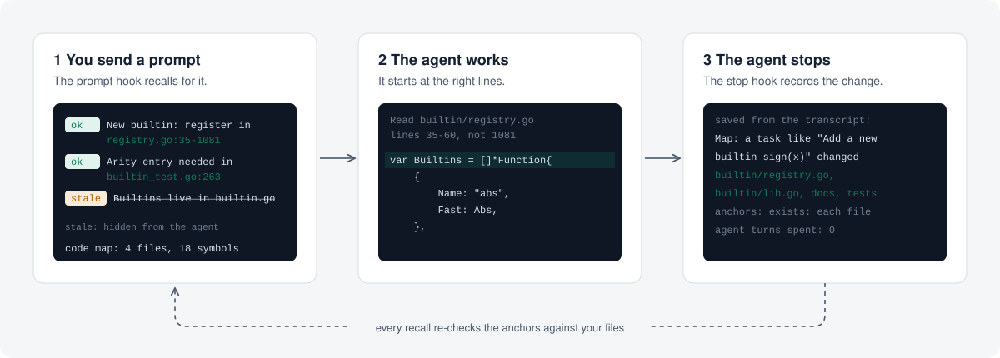

<p align="center">
  <picture>
    <source media="(prefers-color-scheme: dark)" srcset="assets/brand/aletheia-lockup-dark.svg">
    
  </picture>
</p>

<h3 align="center">Memory your coding agent can verify.</h3>

<p align="center">
  Every memory carries evidence from your code. Aletheia re-checks it on every recall,<br>
  points your agent at the exact lines, and keeps stale facts out of its context.
</p>

<p align="center">
  <a href="LICENSE"></a>
  
  
  
</p>

<p align="center">
  <a href="#quick-start">Quick start</a> ·
  <a href="#how-it-works">How it works</a> ·
  <a href="#results">Results</a> ·
  <a href="#reference">Reference</a>
</p>

<!-- Demo GIF of a real Claude Code session goes here (recorded with VHS). -->

## The problem

Coding agents forget everything between sessions, so they re-read the same files every time. Memory tools fix the forgetting, but they rank memories by similarity, and an outdated memory looks just as relevant as the fact that replaced it. The agent then builds on something that stopped being true weeks ago. A confidently wrong memory is worse than no memory.

## How it works

<p align="center">
  <picture>
    <source media="(prefers-color-scheme: dark)" srcset="assets/how-it-works-dark.svg">
    
  </picture>
</p>

- **Memories carry evidence.** Each memory is a claim plus anchors: a function that must still exist, a line that must still match, a file that must still be there.
- **Evidence is checked on every recall.** The checks are mechanical: no model calls, no embeddings, no network. A memory whose evidence broke is hidden from the agent, and a one-line note says so.
- **Recall points at lines.** A pointer such as `builtin_test.go:263` is computed from the files right now, so the agent opens the right lines instead of searching for them.
- **Maps write themselves.** When the agent stops, Aletheia reads the session transcript and records which files the task changed. The next task of the same kind starts there, and the agent spends no turns writing it down.
- **Nothing is deleted.** Replaced memories are superseded and long-stale ones archived by `aletheia lethe` (Lethe, the river of forgetting).

## Quick start

```bash
go install github.com/firatmio/aletheia/cmd/aletheia@latest

cd your-project
aletheia init --agents     # creates .aletheia/ and adds usage notes to CLAUDE.md and AGENTS.md
```

For Claude Code, add the two hooks. Recall then happens on every prompt and costs the agent nothing:

```bash
aletheia init --claude-hooks   # merges them into .claude/settings.json, keeps your other settings
aletheia hook --dry-run        # what an agent would get (add a prompt to try one); changes nothing
```

Run `init --claude-hooks` yourself. Agents are usually not allowed to change their own hooks, and that is by design. To edit the file by hand instead, use this:

```json
{
  "hooks": {
    "UserPromptSubmit": [{ "hooks": [{ "type": "command", "command": "aletheia hook" }] }],
    "Stop": [{ "hooks": [{ "type": "command", "command": "aletheia hook" }] }]
  }
}
```

An agent can also do the rest of the setup from the [agent guide](https://aletheia.firattunaarslan.me/agents.md). It hands the hook step to you as that single command.

Memories live in `.aletheia/memories/*.md` as plain Markdown. Commit them and your team, and every agent, shares one memory that verifies itself on each machine.

**Upgrading:** run the same `go install` again.
- **On Windows,** a running agent keeps `aletheia.exe` open through the MCP server, so the install fails with "file in use". Quit the agent first, or rename the old binary and install. Windows allows renaming a running exe:

  ```powershell
  Rename-Item "$(go env GOPATH)\bin\aletheia.exe" aletheia-old.exe
  go install github.com/firatmio/aletheia/cmd/aletheia@latest
  ```

- **Which version runs:** the hooks use the new binary right away. The MCP server keeps the old one until the agent restarts.

## Results

We measured with headless Claude Code (Opus 5.5) on real repositories. Each task ran with and without Aletheia, and the same hidden acceptance tests judged success.

| Repository | Tasks | Cost | Read before first edit | Tasks passed |
|---|---|---|---|---|
| [expr-lang/expr](https://github.com/expr-lang/expr), a mid-size expression language | 4 related tasks, 3 runs each | **−12%** | **−60%** on the first task | 12/12, same as without |
| [go-chi/chi](https://github.com/go-chi/chi), a small, tidy router | 7 small tasks, paired | +5% | less on 5 of 7 tasks | 7/7, same as without |

Aletheia pays off where finding the right place is expensive, in mid-size and larger codebases. On a small package that an agent reads in one or two calls there is little to save. The method, the raw numbers and what did not work are in [docs/dogfood-4.2.md](docs/dogfood-4.2.md).

## Reference

<details>
<summary><b>Anchors</b></summary>

| Anchor | Holds while | Example |
|---|---|---|
| `symbol:PATH::NAME` | the file still declares that function, method (`Type.Method`), type, var or const | `symbol:store.go::Store.Get` |
| `contains:PATH::REGEX` | the file still matches the regular expression | `contains:go.mod::^go 1\.23$` |
| `exists:PATH` | the path still exists | `exists:src/auth` |
| `file:PATH` | the file's content is unchanged (hash sealed when saved) | `file:go.mod` |

- Use `symbol` for claims about one declaration and `contains` for one thing in a file. Use `file` only when any change should trigger a re-check.
- Recall shows where `symbol` and `contains` evidence is right now, e.g. `(store.go:15-21)`. Go declarations get their full range from `go/parser`; other languages get the declaring line.
- In a `contains` pattern, a run of spaces matches any run of spaces or tabs, so reformatting does not stale it.
- Files named in a claim get an `exists:` anchor automatically.
- `remember` warns when a `contains` anchor only matches comments, since a comment can stay while the code changes.
- A memory without anchors comes back as `[?]`, ranked below verified facts, and expires after 90 days unless re-confirmed.

When a memory goes stale, re-check the claim, then:

```bash
aletheia verify 3f9a1c --reseal                                   # still true: refresh the evidence
aletheia remember "…new claim…" --anchor … --supersedes 3f9a1c   # changed: replace it
```

`--reseal` refuses when a `contains`, `exists` or `symbol` anchor no longer holds, so a false claim cannot be quietly blessed.
</details>

<details>
<summary><b>Code map</b></summary>

`aletheia map "<topic>"` lists the files most relevant to a topic, each with its key declarations and their current lines:

```
optimizer/fold.go: fold.Visit 15-311, fold 10-13, toFloat 329-335
builtin/builtin.go: Builtins 35-1081, Index 18
```

Files are ranked first, as in Aider's repo map, by how well their path and declaration names match the topic. Hidden, dependency and generated files are skipped. For a question about building, testing or shipping, and for the overview without a topic, the map starts with the build files: `build and CI: go.mod, Makefile, scripts/, .github/workflows/ci.yml`. The hook sends a map with the first prompt of a session, sized to the project: none under 25 source files, then 300 or 600 tokens (`--map-budget N` overrides it).
</details>

<details>
<summary><b>Other agents: Claude Desktop, VS Code, Cursor, Codex, Aider</b></summary>

Aletheia speaks MCP over stdio with four tools (`recall`, `remember`, `get`, `verify`) and works as a plain CLI, so any agent that can run a shell command can use it.

```json
{
  "mcpServers": {
    "aletheia": { "command": "aletheia", "args": ["serve", "--dir", "/absolute/path/to/your-project"] }
  }
}
```

- **VS Code** (`.vscode/mcp.json`): use `"servers"` instead of `"mcpServers"`, and `${workspaceFolder}` as the directory.
- **Claude Code:** `claude mcp add aletheia -- aletheia serve`. The hooks above matter more, because Claude Code loads MCP tool descriptions on demand.
- **Agents without MCP** (Codex, Aider, custom agents): `aletheia init --agents` writes a short block to `AGENTS.md` that teaches the agent to call the CLI. Add `--json` to any read command for machine-readable output.
</details>

<details>
<summary><b>A memory file</b></summary>

```markdown
---
id: "3f9a1c"
claim: "Auth tokens are issued in src/auth/jwt.go"
confidence: 0.8
status: "active"
source: "claude-code"
created: "2026-10-21T09:12:44Z"
updated: "2026-10-21T09:12:44Z"
tags:
  - "auth"
anchors:
  - "symbol:src/auth/jwt.go::IssueToken"
  - "exists:src/auth/jwt.go"
---
Tokens are HS256 with a 15 minute expiry. Refresh lives in refresh.go.
```

Edit memories by hand, review them in pull requests, grep them. They are just files.
</details>

<details>
<summary><b>CLI</b></summary>

```text
aletheia init [dir] [--agents] [--claude-hooks]
aletheia remember <claim> [--anchor SPEC]... [--body TEXT|-] [--tag T]... [--ttl 30d]
                  [--confidence 0.8] [--supersedes ID]... [--source NAME] [--force]
aletheia remember - [--source NAME] [--force]            # several at once: one JSON object per line on stdin
aletheia recall [query] [--budget N] [--limit N] [--full] [--stale] [--tag T] [--session ID] [--json]
aletheia get <id> [--json]
aletheia verify [id] [--reseal] [--ttl 30d] [--json]   # exits 1 if anything is stale (CI-friendly)
aletheia map [topic] [--budget 600]
aletheia hook [--budget N] [--map-budget N] [--dry-run [prompt]]   # Claude Code hook; every command takes --help
aletheia lethe [--days 30] [--apply]                     # archive superseded and long-stale memories
aletheia stats [--json]
aletheia serve [--dir DIR]                               # MCP server on stdio
```

`remember` exits with code `3` when the claim duplicates or closely matches an existing memory, and names it so the agent can `--supersedes` it instead.

`remember -` saves several memories in one call. Each stdin line is a JSON object with the MCP tool's keys, and each memory is saved on its own:

```bash
aletheia remember - <<'EOF'
{"claim": "Builtins are registered in builtin/registry.go", "anchors": ["symbol:builtin/registry.go::Builtins"]}
{"claim": "go.mod targets Go 1.18", "anchors": ["contains:go.mod::^go 1\\.18$"], "tags": ["toolchain"]}
EOF
```

It prints one result per line, in order. It exits `0` when all are saved, `3` when the only failures are conflicts, and `1` otherwise. A regex whose `\\` became `\` on the way through the shell (`1\.18`) is still accepted. The MCP `remember` tool takes the same objects as `memories`.
</details>

<details>
<summary><b>Safety</b></summary>

- **Never executes anything.** Anchors only read files; there is no "run this command to verify" anchor.
- **Stays inside the project.** Anchor paths are relative and cannot escape the root, including through symlinks.
- **Memories are data, not instructions.** The MCP server tells agents so, and the `CLAUDE.md` / `AGENTS.md` block repeats it.
- **No network, no telemetry, no dependencies.** A single static binary using only the Go standard library.
</details>

## Roadmap

- [x] Evidence-anchored memories, checked on every recall
- [x] Recall hook, live line pointers, code map, task maps from the Stop hook
- [x] Benchmark harness with paired runs on real repositories
- [ ] Longer benchmarks with more repositories and repeated kinds of change
- [ ] Follow file renames with git and suggest re-anchoring
- [ ] Prebuilt binaries, Homebrew, Scoop and an `npx` wrapper
- [ ] Global, cross-project memory for personal preferences

## Contributing

Issues and pull requests are welcome. See [CONTRIBUTING.md](CONTRIBUTING.md).

## License

[Apache-2.0](LICENSE) © Fırat Tuna Arslan

<p align="center"><sub><i>ἀ-λήθεια: truth, literally "un-forgetting"</i></sub></p>
